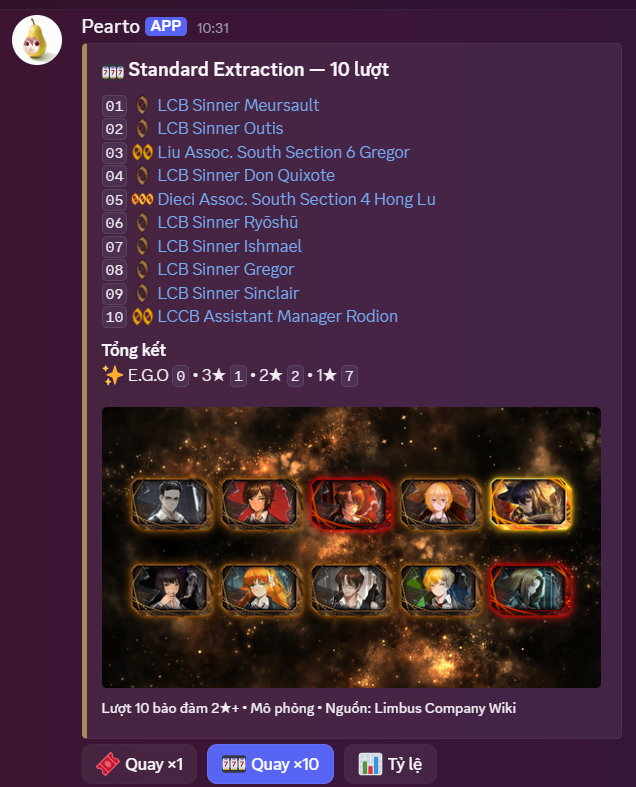

# Peto

Peto là bot Discord đa năng dành cho cộng đồng Việt Nam: nghe nhạc cùng bạn bè, trò chuyện với AI, khám phá game và sử dụng các tiện ích ngay trong server.

[Thêm Peto vào server](https://discord.com/oauth2/authorize?scope=bot%20applications.commands&client_id=1516709319108726944&permissions=92224) · [Giấy phép MIT](LICENSE)

## Tính năng nổi bật

- **Nghe nhạc:** phát nhạc từ YouTube, SoundCloud và liên kết bài hát Spotify; quản lý hàng chờ, lưu playlist, xem lời bài hát và nghe radio.
- **Trợ lý AI:** trò chuyện với bot, hỏi đáp, hỗ trợ học tập, đọc ảnh và video ngắn, tạo hoặc chỉnh sửa ảnh theo yêu cầu.
- **Tải media:** tải nhạc, video và ảnh từ YouTube, TikTok, X/Twitter ngay trong Discord.
- **Limbus Company:** tra cứu Identity, E.G.O, kỹ năng, cốt truyện và gợi ý đội hình.
- **Mô phỏng gacha:** thử vận may với Limbus Company, Blue Archive, Fate/Grand Order và Brown Dust 2.
- **Peto Economy:** kiếm điểm khi chat hoặc tham gia voice, dùng điểm quay gacha, sưu tập nhân vật và xem bảng xếp hạng. Quản trị viên có thể bật riêng cho từng server.
- **Thông báo game:** nhắc lịch reset, theo dõi gift code và video mới từ Project Moon; hỗ trợ đăng ký nhận tin qua DM.
- **Tiện ích cộng đồng:** tìm ảnh Danbooru, tạo sticker/emoji, tìm nguồn ảnh, hiển thị bài đăng mạng xã hội và chào mừng thành viên mới.



## Bắt đầu sử dụng

1. **Thêm Peto** vào server bằng liên kết phía trên.
2. **Gõ `/help`** để xem các nhóm lệnh và hướng dẫn ngay trong Discord.
3. **Thử `/play`** khi đang ở kênh voice, hoặc nhắc `@Peto` để bắt đầu trò chuyện.

Một số lệnh thường dùng:

| Bạn muốn… | Lệnh |
| --- | --- |
| Nghe và điều khiển nhạc | `/play`, `/pause`, `/resume`, `/next`, `/stop` |
| Xem hàng chờ, lưu nhạc | `/queue`, `/favorite`, `/playlist` |
| Tải video hoặc nhạc | `/download` |
| Trò chuyện riêng với AI | `/private` |
| Quay gacha, xem bộ sưu tập | `/gacha`, `/collection`, `/points`, `/rank` |
| Xem gift code, đăng ký nhắc reset | `/coupon codes`, `/dailyreset subscribe` |
| Tìm ảnh, tạo sticker, tìm nguồn ảnh | `/art`, `/sticker`, `/saucy` |
| Cấu hình server | `/settings ai`, `/settings notifications`, `/economy` |

## Tự chạy Peto

Peto được viết bằng Python và `discord.py`, hỗ trợ Windows và Linux. Bạn cần **Python 3.10+**, **FFmpeg**, **Discord Bot Token** và **Tavily API key**. Tính năng AI sử dụng tài khoản SuperGrok hoặc xAI API key.

<details>
<summary>Hướng dẫn cài đặt cơ bản</summary>

### 1. Cài thư viện

Tải mã nguồn, mở terminal tại thư mục dự án rồi chạy:

**Windows (PowerShell)**

```powershell
py -m venv .venv
.\.venv\Scripts\Activate.ps1
pip install -r requirements.txt
Copy-Item .env.example .env
```

**Linux**

```bash
python3 -m venv .venv
source .venv/bin/activate
pip install -r requirements.txt
cp .env.example .env
```

### 2. Cấu hình

- Cài FFmpeg và kiểm tra bằng `ffmpeg -version`.
- Điền `DISCORD_TOKEN` và `TAVILY_API_KEY` trong `.env`.
- Đăng nhập SuperGrok bằng `python -m xai_oauth login`, hoặc điền `XAI_API_KEY` trong `.env`.
- Trong Discord Developer Portal, bật **Message Content Intent**. Nếu bật tính năng chào mừng (`WELCOME_ENABLED=true`), bật thêm **Server Members Intent**.
- Mời bot với scope `bot` và `applications.commands`; cấp quyền xem kênh, gửi tin nhắn, nhúng liên kết, đính kèm tệp, kết nối và nói trong voice. Tính năng hiển thị bài đăng mạng xã hội cần thêm **Manage Messages**.

Các tùy chọn bổ sung được giải thích trong [`.env.example`](.env.example).

### 3. Khởi động

```bash
python bot.py
```

</details>

## Quyền riêng tư

Peto có thể ghi nhớ nội dung trò chuyện để hỗ trợ các lần trao đổi sau. Dùng `/andanh` để trò chuyện không đọc hoặc lưu trí nhớ dài hạn, và `/resetmemory` để xóa trí nhớ của bạn.

Khi tự chạy bot, hãy giữ kín token, API key, cookie và dữ liệu người dùng.

## Ghi nhận

Phát triển bởi [PeaGy](https://github.com/PeaGy). Cảm ơn **Ryuz-V** và **rapi-bot — mascarell**.

Dự án được phát hành theo [giấy phép MIT](LICENSE).
